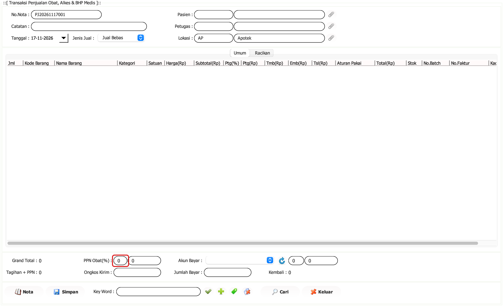

# Implementasi PPN Obat 0% (Release v3)

| | |
|---|---|
| Versi aplikasi | 826.v3.1 |
| Branch rilis | `rskj/release/v3` |
| Branch fitur | `rskj/v3/feature/ppn-0`, digabung lewat PR [#8](https://github.com/rofyfirm/SIMRS-Khanza/pull/8) (merge `175f40834`) |
| Commit | [`b5738e4f1`](https://github.com/rofyfirm/SIMRS-Khanza/commit/b5738e4f10b9561ccec5ddcc85a1a5c2f7356c00) "Change PPN to 0%" |
| Tanggal | 3 September 2026 |
| File yang diubah | `src/inventory/DlgPenjualan.form`, `src/inventory/DlgPenjualan.java` |
| Perubahan database | Tidak ada |
| Masih berlaku di | v3a, v4, v5, v6, v7 (dicek: nilai awal tetap `0`) |

## Ringkasan

Isian **PPN Obat (%)** pada form **Transaksi Penjualan Obat, Alkes & BHP Medis** sekarang terisi `0` saat form dibuka. Sebelumnya isian ini terisi `11`, sehingga setiap penjualan obat otomatis dikenai PPN 11% kecuali petugas mengubahnya secara manual.

Isian tetap bisa diedit. Kalau ada transaksi yang memang harus dikenai PPN, petugas cukup mengetik persentasenya dan tagihan langsung dihitung ulang.



*Form Transaksi Penjualan Obat, Alkes & BHP Medis saat baru dibuka. Kotak merah: isian PPN Obat (%) bernilai 0. Data contoh fiktif.*

## Cakupan

**Yang berubah**

Perubahan ini berlaku untuk form `inventory.DlgPenjualan` (penjualan obat, alkes, dan BHP). Di v3, form ini dibuka dari:

| Tempat | Menu | Kode (v3) |
|---|---|---|
| Menu Utama | **Penjualan Obat & BHP** | `frmUtama.btnPenjualanActionPerformed` |
| Menu Utama | **Input Penjualan Obat & BHP** | `frmUtama.btnInputPenjualanActionPerformed` |
| Kasir Ralan | klik kanan → **Penjualan Obat/Alkes/Barang** | `DlgKasirRalan.MnPenjualanActionPerformed`, `MnPenjualan1ActionPerformed` |
| Kamar Inap | klik kanan → **Penjualan Obat/Alkes/Barang** | `DlgKamarInap.MnPenjualan1ActionPerformed` |
| Billing Ralan | klik kanan → **Penjualan Obat/Alkes/Barang** | `DlgBilingRalan.MnPenjualanActionPerformed` |

Setiap jalur di atas membuat objek form baru (`new DlgPenjualan(...)`), jadi setiap kali form dibuka, PPN Obat selalu mulai dari 0. Mulai v5, daftar menu Menu Utama dipindah ke `DaftarMenuUtama.java`, sehingga form dibuka dari sana, tetapi perilakunya sama.

**Yang tidak berubah**

- PPN obat di peresepan dokter, input obat rawat jalan, piutang obat, billing rawat jalan, dan apotek BPJS. Bagian-bagian ini diatur oleh `set_nota.tampilkan_ppnobat_ralan` / `tampilkan_ppnobat_ranap` melalui `fungsi/ppnralan.java` dan `fungsi/pengaturanbillingralan.java`.
- PPN akun bayar, yaitu isian di sebelah kanan **Akun Bayar**. Nilainya tetap diambil dari data akun bayar lewat `cariPPN()` ([DlgPenjualan.java:4408](../../src/inventory/DlgPenjualan.java#L4408)).
- Struktur tabel, nota, dan laporan.

## Perubahan kode

Perubahan ada di dua file, masing-masing satu baris.

[DlgPenjualan.form:593](../../src/inventory/DlgPenjualan.form#L593) adalah sumber desain GUI NetBeans:

```diff
 <Component class="widget.TextBox" name="PersenppnObat">
   <Properties>
-    <Property name="text" type="java.lang.String" value="11"/>
+    <Property name="text" type="java.lang.String" value="0"/>
```

[DlgPenjualan.java:752](../../src/inventory/DlgPenjualan.java#L752) berada di dalam `initComponents()`, kode yang dihasilkan NetBeans dari file `.form`:

```diff
-        PersenppnObat.setText("11");
+        PersenppnObat.setText("0");
```

Kedua file harus diubah bersamaan. `initComponents()` dibuat ulang oleh NetBeans dari file `.form` setiap kali form disimpan di GUI designer. Jika hanya file `.java` yang diubah, nilainya akan kembali menjadi `11` saat form berikutnya diedit di NetBeans.

## Cara perhitungan

Perhitungan tagihan ada di `isKembali()` ([DlgPenjualan.java:3878](../../src/inventory/DlgPenjualan.java#L3878)). Metode ini dipanggil setiap kali isian PPN Obat berubah (DocumentListener di [baris 293](../../src/inventory/DlgPenjualan.java#L293)).

```text
PPN Obat (Rp)  = PPN Obat (%) / 100 × total obat
PPN akun (Rp)  = PPN akun bayar (%) / 100 × (total obat + PPN Obat)
Tagihan + PPN  = total obat + PPN Obat + PPN akun
Kembali        = jumlah bayar − Tagihan + PPN − ongkos kirim
```

Contoh untuk total obat Rp100.000, akun bayar tanpa PPN, dan tanpa ongkos kirim:

| | Sebelum (11%) | Sesudah (0%) |
|---|---:|---:|
| PPN Obat | Rp11.000 | Rp0 |
| Tagihan + PPN | Rp111.000 | Rp100.000 |

## Dampak pada data yang disimpan

- **Tabel `penjualan`**: kolom `ppn` menyimpan nilai PPN Obat dalam rupiah ([baris 1340](../../src/inventory/DlgPenjualan.java#L1340)), jadi bernilai `0`.
- **Jurnal**: jika `set_nota.verifikasi_penjualan_di_kasir = 'No'`, form langsung membuat jurnal. Baris **PPN KELUARAN** hanya ditambahkan bila PPN Obat lebih dari 0 ([baris 4318](../../src/inventory/DlgPenjualan.java#L4318)). Dengan PPN 0%, jurnal hanya berisi Penjualan Obat Bebas, akun bayar (total + ongkir), HPP Obat Jual Bebas, dan Persediaan Obat Jual Bebas. Jika pengaturan bernilai `'Yes'`, form ini tidak membuat jurnal.
- **Tabel `tagihan_sadewa`**: nilai tagihan = total + ongkir + PPN Obat, jadi tanpa PPN.
- **Nota apotek** (`billing/NotaApotek.php`): parameter `besarppn` = PPN akun + PPN Obat.

## Catatan: nilai PPN setelah Simpan

Commit ini hanya mengubah nilai **saat form dibuka**. Setelah Simpan berhasil, form dikosongkan untuk transaksi berikutnya. Pada saat itu, isian PPN Obat diisi ulang berdasarkan `set_nota.tampilkan_ppnobat_ralan` ([baris 1418–1422](../../src/inventory/DlgPenjualan.java#L1418)). Pengaturan ini dibaca saat form dibuka ([baris 1890](../../src/inventory/DlgPenjualan.java#L1890)).

| `set_nota.tampilkan_ppnobat_ralan` | Saat form dibuka | Setelah Simpan |
|---|---|---|
| `No` | 0 | 0 |
| `Yes` | 0 | **11** |

Di database uji lokal `tembak_rskj`, pengaturan ini bernilai `No`, jadi PPN Obat tetap 0 setelah Simpan. Kalau di server produksi bernilai `Yes`, transaksi kedua dan seterusnya dalam jendela yang sama akan kembali memakai 11%.

Pengaturan yang sama juga dipakai peresepan dokter, input obat rawat jalan, piutang obat, billing rawat jalan, dan apotek BPJS. Karena itu, jangan mengubahnya hanya demi form ini. Kalau perilaku setelah Simpan juga harus 0%, yang perlu diubah adalah `PersenppnObat.setText("11")` di baris 1419.

## Cara verifikasi

1. Buka **Penjualan Obat & BHP** dari Menu Utama (atau dari jalur lain di bagian Cakupan). Isian **PPN Obat (%)** harus berisi `0`, dan **Tagihan + PPN** harus sama dengan **Grand Total**.
2. Tambahkan obat, lalu periksa bahwa PPN Obat (Rp) tetap `0`.
3. Ketik `11` pada PPN Obat (%). Tagihan + PPN harus langsung bertambah 11%. Kembalikan ke `0`.
4. Klik Simpan, lalu cek isian PPN Obat untuk transaksi berikutnya (lihat tabel di atas).
5. Di database, cek `select nota_jual, ppn from penjualan order by nota_jual desc limit 1`. Kolom `ppn` harus `0`. Jika jurnal dibuat langsung, cek juga bahwa nota tersebut tidak punya baris PPN KELUARAN:

   ```sql
   select d.kd_rek, d.debet, d.kredit
   from jurnal j join detailjurnal d on d.no_jurnal = j.no_jurnal
   where j.no_bukti = '<no nota>';
   ```

Untuk dokumentasi ini, yang sudah diperiksa hanya langkah 1, melalui screenshot di atas dari build branch `rskj/release/v3` dengan data contoh. Langkah 2–5 belum dijalankan.

## Catatan pemeliharaan

- Upstream (`master`) masih memakai `11` di [DlgPenjualan.java:752](../../src/inventory/DlgPenjualan.java#L752) dan [DlgPenjualan.form:593](../../src/inventory/DlgPenjualan.form#L593). Saat menggabungkan pembaruan dari upstream (misalnya merge `rskj/merge/v7-maswin`), pastikan kedua baris tetap `0`. Per v7 nilainya masih `0`.
- Untuk rollback, ubah kedua baris tersebut kembali ke `11`, lalu build ulang.
- Perubahan yang sama juga ada sebagai commit `8be16f319` di branch `rskj/release/v3-test-latest-mas-win`. Isinya sama dengan `b5738e4f1`.
